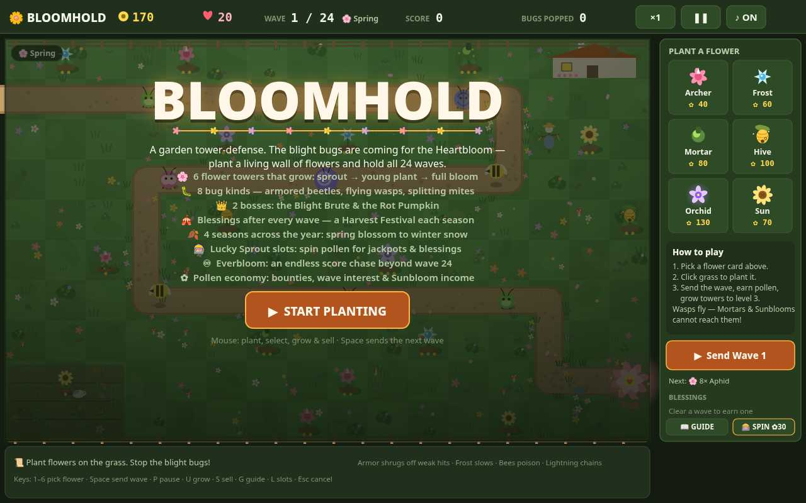

# Bloomhold — a garden tower-defense

The blight bugs are marching on the Heartbloom. Plant a living wall of
flower towers along their winding dirt path and hold **all 24 waves**.



## How to play

- **Plant**: pick a flower card in the sidebar, then click a grass tile.
- **Send the wave** with the orange button (or Space) when you're ready.
- **Grow** towers to level 3 and **sell** them from the selection panel.
- Pollen comes from bounties, a wave-clear bonus plus interest, and
  Sunblooms. If 20 bugs reach the Heartbloom, the garden falls.

## The garden

- **6 flower towers** — Petal Archer (fast, hits air), Frostbloom
  (slowing splash), Thorn Mortar (heavy splash), Beehive (poison bees),
  Storm Orchid (chain lightning), Sunbloom (pollen income) — each with
  3 growth levels.
- **8 bug kinds** — Aphids, Mites, armored Shell Beetles, Gloom Snails,
  flying Wasps (Mortars and Sunblooms can't reach them), Splitters that
  burst into Mites, and two bosses: the **Blight Brute** (wave 12) and
  the **Rot Pumpkin** (wave 24), both shedding smaller bugs as they walk.
- Full HUD (pollen, lives, wave, score, kills), wave previews, pause and
  ×1/×2/×3 speed, procedural WebAudio sound, and win/lose screens with a
  score breakdown and restart.
- **A farming year**: the 24 waves are four seasons (Spring, Summer,
  Autumn, Winter) with their own palettes, weather and farm props —
  crop rows, a farmhouse, a scarecrow, one wandering hen. Towers grow
  through visible stages: seed mound → sprout → full bloom.
- **Blessings & Harvest Festivals**: after every wave the garden offers
  1 of 3 stackable blessings; when a season turns, the choice is framed
  as a Harvest Festival.
- **Everbloom** (endless mode): win the campaign and the victory screen
  offers to keep the same garden into procedurally scaling waves 25+ —
  a score chase that ends only when the Heartbloom falls.
- **Lucky Sprout**: a 3-reel garden slot between waves — spin pollen
  for jackpots, a random blessing, +lives or a Bee Frenzy (bounded,
  hard-capped, rolls on its own seeded stream).
- **Field guide**: an in-game bestiary panel whose rows are derived
  from the actual enemy/tower data, so it can never drift from the game.

## Run it

```
node serve.ts        # then open http://localhost:8080
```

The game is plain static files under `game/` — no build step, no network
requests, everything drawn in code on a canvas.

## Hand-in (make.fun best-game-01)

```
mkdir -p out && MAKEFUN_OUTPUT_DIR=out node main.ts
```

copies `game/` + `screenshots/` to the output directory and writes
`dossier.json` via the vendored `vendor/makefun-game.ts`.
